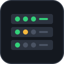
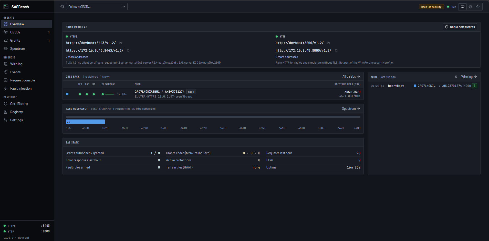
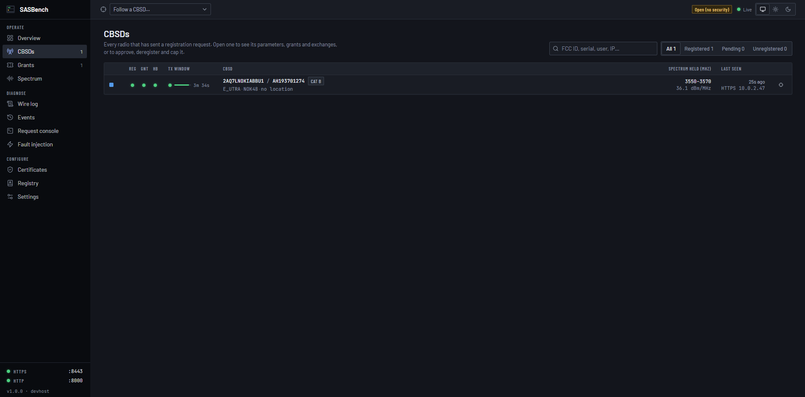
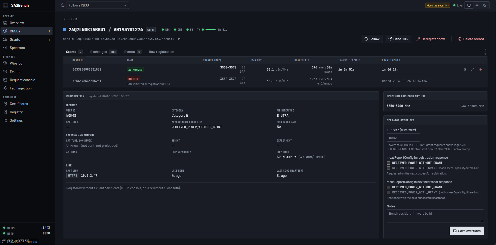
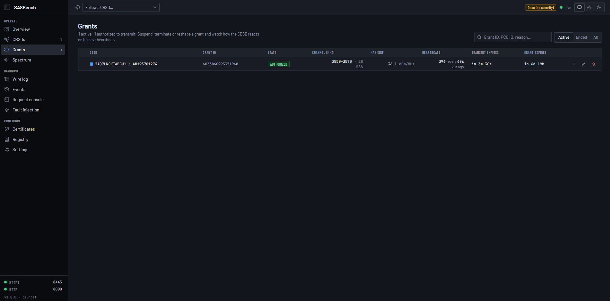
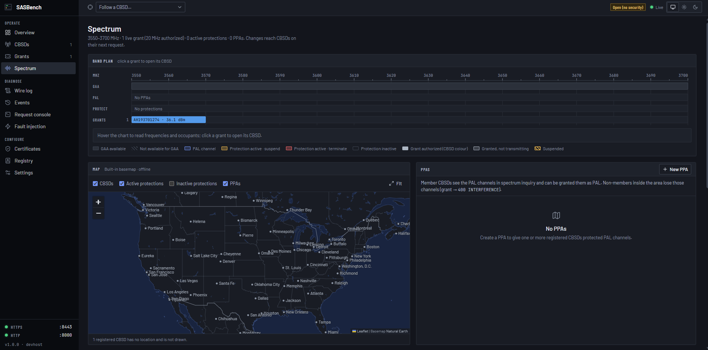
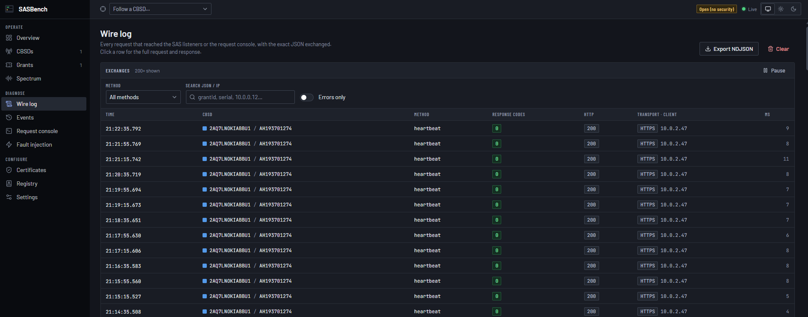
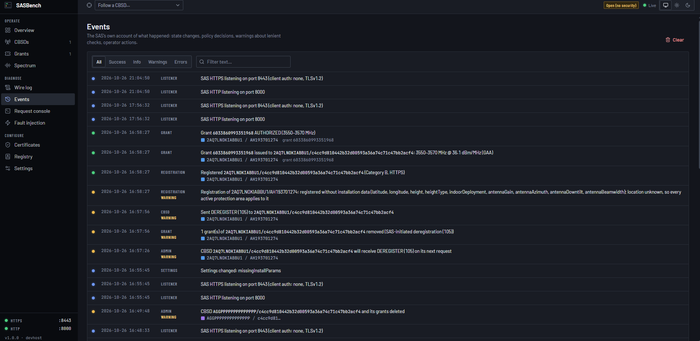
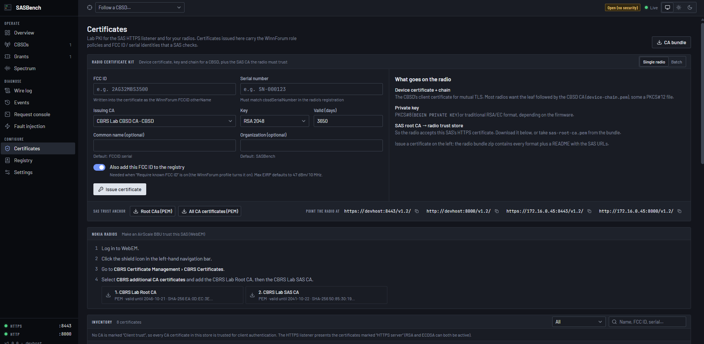
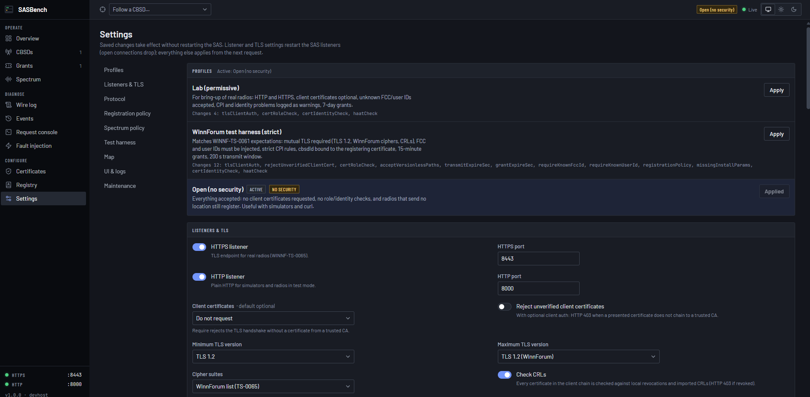

<div align="center">



# SASBench

**A lab Spectrum Access System for testing CBRS radios.**

Register, grant and heartbeat real CBSDs on your bench, see exactly what the radio and the SAS say to each other,<br>and make the SAS answer the way your test needs.

[](https://github.com/paulmataruso/SASBench/actions/workflows/ci.yml)
[](docs/GUIDE.md#what-the-sas-can-do)
[](docs/GUIDE.md#tls-behaviour-winnf-ts-0065)
[](docs/INSTALL.md)
[](docs/DEVELOPMENT.md)
[](LICENSE)

[Install](docs/INSTALL.md) · [User guide](docs/GUIDE.md) · [REST API](docs/API.md) · [Radios](RADIOS.md) · [Development](docs/DEVELOPMENT.md) · [Changelog](CHANGELOG.md)

</div>

<br>



> [!IMPORTANT]
> SASBench is a test tool, not a certified SAS. It has no FCC or Wireless Innovation Forum certification and must not be used to authorize transmissions outside a controlled test environment.

## Why SASBench

Commercial SAS services give a lab little visibility and no control. Simple stubs answer "success" to everything. SASBench follows the WInnForum specifications, runs on your own network, and puts every decision in front of you.

- **The real protocol.** WINNF-TS-0016 v1.2: registration (including CPI-signed installation data and preloaded registrations), spectrum inquiry, grant, heartbeat, relinquishment and deregistration, with batched Domain Proxy requests.
- **The WInnForum TLS profile.** WINNF-TS-0065: TLS 1.2, the WInnForum cipher suites, RSA and ECDSA server certificates, mutual TLS, role and identity checks, and revocation.
- **A PKI in the box.** A root CA with SAS, CBSD, Domain Proxy and Installer CAs is created on first start. Radio certificate bundles come in every format firmware asks for: PEM, DER, PKCS#1, PKCS#8, PKCS#12 and legacy PKCS#12.
- **See everything.** The wire log keeps the full request and response JSON of every exchange, including failed TLS handshakes, live in the browser and exportable as NDJSON.
- **Make the SAS misbehave on purpose.** Suspend or terminate grants, change heartbeat intervals, send 105 deregistrations, or inject faults: rewritten response codes, HTTP errors, delays, dropped connections and malformed JSON.
- **Incumbents and protection.** NTIA E-DPA and P-DPA definitions, PPAs, FSS earth stations and exclusion zones, plus the Category A HAAT check from USGS terrain data.
- **Ready for the WInnForum harness.** Its admin API, a strict profile that matches its expectations, and a generated `sas.cfg`.
- **A complete REST API.** Everything the console does, every harness admin call and every stored record, over HTTP with read-only or read-write API keys and an OpenAPI 3.1 description, for test rigs and CI pipelines.
- **User accounts.** Sign-in for the console and the API, with admin, operator and viewer roles, managed on the Users page.
- **Offline and self-contained.** One Docker container, a SQLite database, a built-in basemap and offline map tiles. No cloud account.

Radios that register without location data, as many Category B units do, are handled explicitly: hold them for preloaded data, or register them anyway. The console includes step-by-step certificate instructions for Nokia AirScale BBUs.

**Confirmed radios** are listed in [RADIOS.md](RADIOS.md): so far the Baicells Nova 430i, the Nokia AirScale AMIA + ASIA + AZQC and the Sercomm SCE5164-B48. Tested one that is not there? Add it with a pull request.

## Screenshots

<table>
  <tr>
    <td width="50%"><a href="docs/screenshots/CBSD.png"></a><br><b>CBSDs.</b> Every radio as one rack row, with live LEDs, transmit window, held spectrum and last link.</td>
    <td width="50%"><a href="docs/screenshots/CBSD-Detail.png"></a><br><b>CBSD detail.</b> Grants, exchanges, events and registration data, with operator overrides and actions such as Send 105.</td>
  </tr>
  <tr>
    <td width="50%"><a href="docs/screenshots/Grants.png"></a><br><b>Grants.</b> Every grant with its channel, EIRP, heartbeats and expiry. Suspend, edit or terminate any of them.</td>
    <td width="50%"><a href="docs/screenshots/Spectrum.png"></a><br><b>Spectrum.</b> The band plan with GAA, PAL, protections and grants, and the map of CBSDs and protection areas.</td>
  </tr>
  <tr>
    <td width="50%"><a href="docs/screenshots/Wirelog.png"></a><br><b>Wire log.</b> Every exchange with its response code, HTTP status, transport and timing. Open one for the exact JSON.</td>
    <td width="50%"><a href="docs/screenshots/Events.png"></a><br><b>Events.</b> The SAS’s own account of what happened: state changes, policy decisions, warnings and operator actions.</td>
  </tr>
  <tr>
    <td width="50%"><a href="docs/screenshots/Certs.png"></a><br><b>Certificates.</b> Radio certificate kits from the built-in lab PKI, and step-by-step trust setup for Nokia AirScale BBUs.</td>
    <td width="50%"><a href="docs/screenshots/Settings.png"></a><br><b>Settings.</b> Profiles and live settings for listeners, TLS, protocol and policy, applied without a restart.</td>
  </tr>
</table>

## Quick start

On a Linux host with Docker:

```bash
git clone https://github.com/paulmataruso/SASBench.git
cd SASBench
docker compose up -d --build
```

Then open the console at `http://<host-ip>:8080`, sign in as **`admin` / `admin`** and change the password (account menu → **Your account**). Point the radio at the SAS:

| Port | Purpose |
|------|---------|
| `8080` | Web console and REST API |
| `8443` | SAS–CBSD protocol over HTTPS: `https://<host>:8443/v1.2/` |
| `8000` | SAS–CBSD protocol over plain HTTP: `http://<host>:8000/v1.2/` |

The **Overview** page lists the exact URLs, and the **Certificates** page makes the radio's credentials. To set the name radios use (`SAS_FQDN`), the bind address, ports or the starting profile, copy `.env.example` to `.env` and edit it. [INSTALL.md](docs/INSTALL.md) covers requirements, configuration, Docker Desktop, upgrades and backups.

## REST API

Everything is scriptable through the REST API at `http://<host>:8080/api/v1`. Create an API key on the console's **API keys** page, then:

```bash
KEY=sasb_...
curl -s -H "Authorization: Bearer $KEY" http://<host>:8080/api/v1/cbsds | jq '.items[] | {cbsdId, state}'
curl -s -X POST http://<host>:8080/api/v1/faults -H "Authorization: Bearer $KEY" -H 'Content-Type: application/json' \
  -d '{"method": "heartbeat", "action": "response_code", "responseCode": 501, "remaining": 1}'
```

The [API guide](docs/API.md) covers authentication and conventions, with recipes for every area. The [API reference](docs/API-REFERENCE.md) lists all 176 operations, each with a real example request and response. The running SAS serves its OpenAPI 3.1 description at `/api/v1/openapi.json`.

## Documentation

| Document | Covers |
|---|---|
| [Install](docs/INSTALL.md) | Requirements, Docker Compose, configuration, firewall, upgrading, backup and restore, troubleshooting |
| [User guide](docs/GUIDE.md) | The console, users and API keys, connecting radios, certificates, TLS, settings profiles, the registry, map, terrain, the WInnForum test harness, limitations |
| [API guide](docs/API.md) | The REST API: authentication, users, API keys and scopes, conventions, and recipes for every area |
| [API reference](docs/API-REFERENCE.md) | Every endpoint, parameter and schema, each with a real `curl` example and response (generated from the code) |
| [API architecture](docs/API-ARCHITECTURE.md) | How the API is built and secured, how it is tested, how to extend it |
| [Development](docs/DEVELOPMENT.md) | Running from source, project layout, tests, third-party notices |
| [Radio compatibility](RADIOS.md) | Radios confirmed to work with SASBench, and how to add yours |
| [Changelog](CHANGELOG.md) | Release notes |
| [Security](SECURITY.md) | Reporting a vulnerability |

## Support

Bug reports and radio compatibility reports are welcome in [GitHub Issues](https://github.com/paulmataruso/SASBench/issues). Include the radio model and firmware, the SASBench version, and the relevant exchanges exported from the wire log.

SASBench is proprietary software, so code pull requests are not accepted. Pull requests that add a tested radio to [RADIOS.md](RADIOS.md) are welcome; see [CONTRIBUTING.md](CONTRIBUTING.md).

## License

Copyright © 2026 Paul Mataruso. All rights reserved. SASBench is proprietary software; see [LICENSE](LICENSE). For an evaluation or commercial license, contact [paulmataruso](https://github.com/paulmataruso) on GitHub.

SASBench includes open-source components under their own licenses, listed with their license texts in [THIRD_PARTY_NOTICES.md](THIRD_PARTY_NOTICES.md).

<sub>CBRS is the Citizens Broadband Radio Service. Nokia and AirScale are trademarks of Nokia Corporation. SASBench is an independent product and is not affiliated with or endorsed by Nokia, the Wireless Innovation Forum or the FCC.</sub>
