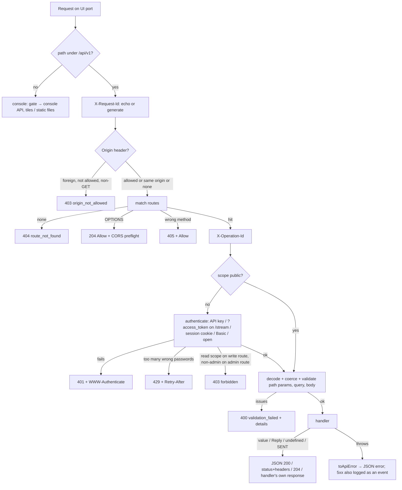

# SASBench API architecture

This document explains how the public REST API (`/api/v1`) is built: where it sits in the process, how a request flows through it, how it is secured, how the OpenAPI document and the reference are produced from the code, and how it is tested. It is for people changing the API or reviewing it. To use the API, read [API.md](API.md). For the endpoint list, read [API-REFERENCE.md](API-REFERENCE.md).

- [Goals and constraints](#goals-and-constraints)
- [Where the API sits](#where-the-api-sits)
- [Source layout](#source-layout)
- [The route table](#the-route-table)
- [Request pipeline](#request-pipeline)
- [Validation](#validation)
- [Errors](#errors)
- [Authentication and authorization](#authentication-and-authorization)
- [Browser safety: origin check and CORS](#browser-safety-origin-check-and-cors)
- [Secrets and redaction](#secrets-and-redaction)
- [Settings metadata](#settings-metadata)
- [Protocol requests: internal and loopback transports](#protocol-requests-internal-and-loopback-transports)
- [Background jobs, listeners and the stream](#background-jobs-listeners-and-the-stream)
- [OpenAPI document and generated reference](#openapi-document-and-generated-reference)
- [The boundary with the SAS core](#the-boundary-with-the-sas-core)
- [Design decisions and the plan critique](#design-decisions-and-the-plan-critique)
- [Testing](#testing)
- [Extending the API](#extending-the-api)

## Goals and constraints

1. **Everything, over HTTP.** Every function the console offers, every harness admin call, and read access to every stored datum. The API has 176 operations in 25 groups.
2. **No change to how the SAS works.** The protocol engine, registration and grant policy, fault injection, the harness admin implementation and the PKI are not modified. The API calls them; it never reimplements them. The WInnForum harness suites must pass unchanged.
3. **One source of truth.** Dispatch, input validation, the OpenAPI document and the Markdown reference all come from the same route table, so they cannot disagree.
4. **No new dependencies.** The server's only runtime dependency stays `fflate`. Validation, OpenAPI generation, coverage and docs generation are small in-repo code.
5. **Safe by default on a lab network.** Every call needs a user account or an API key, roles limit what each may do, cross-site browser attacks are refused, and secrets never leave through read paths.

## Where the API sits

SASBench is one Node.js process with three listeners:

```
                          ┌──────────────────────────── SASBench process ───────────────────────────┐
 radios, harness  ──────► │ SAS HTTP  :8000 ─┐                                                        │
 radios, harness  ──────► │ SAS HTTPS :8443 ─┴► SasServer ─► fault rules ─► Engine (WINNF-TS-0016)     │
                          │                         │                          │                      │
                          │                         └── harness admin ─► SasAdmin (WINNF-TS-0096)      │
                          │                                                    │                      │
 browser console ───────► │ UI :8080 ─┬─ /api/v1/* ─► API v1 dispatcher ─► routes ─┬─► Engine, SasAdmin, │
 scripts, CI, tools ────► │           │                                        │   Pki, SettingsStore, │
                          │           ├─ /api/*   ─► console API (private)     │   TileStore, Terrain, │
                          │           └─ /*       ─► static console            │   Db, Bus            │
                          │                                                    └─► loopback ─► :8000/:8443
                          └───────────────────────────────────────────────────────────────────────────┘
```

`server/src/index.ts` builds the shared objects once and hands the same instances to the SAS listeners, the console API and API v1: the database, settings store, event bus, PKI, engine, admin, tile store and downloaders, and the accounts, sessions and key stores (`Auth`). API v1 is therefore a second front end on the same state. A change made through it is visible in the console at once, and the reverse is also true. The bus `changed` notifications reach both.

The UI request handler routes `/api/v1` and `/api/v1/*` to the v1 dispatcher, which authenticates and reports errors itself, in its own JSON format. The console's own data (`/api/*`, map tiles) passes through the same `Auth` with the console's rules ([below](#the-console)). When `SAS_API_PORT` is set, a fourth listener serves `/api/v1` alone. The SAS protocol listeners and the harness admin API on them are not behind sign-in: radios and the WInnForum harness authenticate with TLS client certificates, as the specifications require.

## Source layout

```
server/src/api/v1/
├── index.ts          dispatcher: CORS/origin check, routing, auth, validation, handler, errors
├── http.ts           shared types (Route, Ctx, V1Deps), ApiError, Reply helpers (created, accepted, …), sendFile, page
├── schema.ts         JSON Schema subset: validator, query coercion, S.* schema builders
├── components.ts     named response schemas (Cbsd, Grant, Certificate, Error, …) for OpenAPI and tests
├── openapi.ts        OpenAPI 3.1 generator, tag descriptions
├── auth.ts           ApiTokens (hashed key store) and Auth (principals, password cache, throttle)
├── settingsMeta.ts   type, range, group, unit and restart flag of every setting
├── mappers.ts        database rows → API objects (reuses the console's mappers)
└── routes/
    ├── index.ts      ROUTES: every module's routes, in documentation order
    ├── common.ts     paging and cursor helpers, shared parameter specs, response helpers
    ├── system.ts     index, health, openapi.json, status, system, activity, reference
    ├── tokens.ts     API keys, whoami
    ├── users.ts      user accounts, sessions, your own password
    ├── settings.ts   settings, schema, profiles, reset; applySettings() and cross-checks
    ├── cbsds.ts      CBSDs and their grants, events, messages, availability, actions
    ├── grants.ts     grants and SAS-side grant actions
    ├── sas.ts        protocol requests (internal / loopback HTTP / HTTPS)
    ├── registry.ts   FCC IDs, user IDs, blacklist, conditional registrations, CPI users
    ├── spectrum.ts   spectrum overview, protections, DPAs, PPAs, incumbents
    ├── faults.ts     fault rules
    ├── logs.ts       wire log, event log, exports, SSE stream
    ├── operations.ts daily activities, triggers, flags, reset, listeners
    ├── harness.ts    harness admin passthrough, sas.cfg
    ├── certs.ts      PKI, TLS configuration, CRLs, CPI signing
    ├── map.ts        map configuration, tile sets, tile downloads
    ├── terrain.ts    terrain inventory, elevation, HAAT, terrain downloads
    ├── config.ts     configuration export/import, database backup
    └── data.ts       read-only table browser

server/src/auth/users.ts           accounts, password hashing, sessions
server/src/auth/console.ts         the console's sign-in routes and gate()
server/src/tools/reset-password.ts command-line password reset
server/src/tools/terrainFetch.ts   terrain download code shared by the CLI and the API job
server/test/api-v1.test.ts         black-box test of every operation
server/test/auth.test.ts           first-start admin, throttle, reset tool, SAS_AUTH=off
scripts/api-reference.mjs          generates docs/API-REFERENCE.md (and checks it in CI)
scripts/api-examples.mjs           captures a real request and response per operation (docs/api-examples.json)
scripts/api-coverage.mjs           V8 line/function coverage of server/src/api/v1 and server/src/auth
```

## The route table

Each endpoint is one static object:

```ts
{
  method: 'POST', path: '/grants/{grantId}/terminate', operationId: 'terminateGrant', tag: 'Grants', scope: 'write',
  summary: 'Terminate a grant',
  description: 'The grant ends now; the CBSD\'s next heartbeat for it is answered with 500 TERMINATED_GRANT.',
  params: { grantId: { description: 'Grant id.', schema: S.str({ minLength: 1 }) } },
  body: { schema: S.obj({ reason: S.str({ maxLength: 500, description: '…' }) }), example: { reason: 'interference test' } },
  responses: okRef('The ended grant.', 'Grant'),
  handler: ({ d, params, body }) => { … },
}
```

| Field | Used by |
|---|---|
| `method`, `path` | Dispatcher (matching, 405 `Allow`), OpenAPI paths. `{name}` is one segment; `{name+}` matches the rest of the path (used only by the harness passthrough). |
| `operationId` | Unique, stable name: `X-Operation-Id` header, OpenAPI, the reference, test guards |
| `tag`, `summary`, `description` | OpenAPI and the reference |
| `scope` | Authorization: `public`, `read`, `write` or `admin` |
| `params`, `query`, `body` | Validation (and coercion of path and query strings), OpenAPI parameters and request bodies |
| `responses` | OpenAPI responses. The test validates every real response against them. |
| `errors` | Extra error statuses beyond those the generator infers |
| `handler` | Does the work. Returns a value (200 JSON), a `Reply` (other status, headers), `undefined` (204), or `SENT` when it wrote the response itself. |

At start-up the dispatcher compiles each path to a regular expression and sorts the routes by specificity. A literal segment outranks a parameter, which outranks a catch-all, so `/grants/ended` wins over `/grants/{grantId}`. It also refuses to start if a method and path or an `operationId` is duplicated.

## Request pipeline



These details matter:

- **Bodies are drained on early errors.** On 401, 403, 404, 405 and 429 the dispatcher reads the request body before answering, so keep-alive connections stay usable.
- **Query strings are strict.** Every query parameter must be declared on the route. Repeated keys use the first value. List parameters are comma-separated and declared as arrays.
- **Path parameters are percent-decoded once, then validated.** Invalid percent-encoding is a validation error, not a crash.
- **Optional bodies.** A route whose body is optional and an object receives `{}` when the request has no body, so handlers never test for `undefined`.
- **Every successful JSON response** is sent with `Content-Length` and `Cache-Control: no-store`. `HEAD` runs the GET handler and sends headers only. Handlers that write their own response honour `c.head`.

## Validation

`schema.ts` implements the subset of JSON Schema 2020-12 the API needs:

- `type`, including type arrays such as `["string", "null"]`;
- `enum`, `const`;
- `minimum`, `maximum`, `minLength`, `maxLength`, `pattern`;
- `items`, `minItems`, `maxItems`;
- `properties`, `required`, `additionalProperties` (boolean or schema);
- `oneOf`, `anyOf`;
- `$ref` to named components.

Because this is OpenAPI 3.1's own schema dialect, the same objects are published unchanged in the OpenAPI document. There is no translation layer that could drift.

Schemas are written with small builders. `S.obj` defaults to `additionalProperties: false`, which is what makes unknown fields an error:

```ts
S.obj({ name: S.str({ minLength: 1, maxLength: 200 }), scope: S.enum(['read', 'write']) }, ['name', 'scope'])
S.time()   // epoch ms integer or RFC 3339 string (anyOf), normalised with toMs()
S.hz()     // integer Hz
S.nullable(S.int())
```

`coerceQuery()` turns path and query strings into the schema's type before validation: integers and numbers, booleans (`true/false/1/0/yes/no`), and comma-separated arrays. A value that cannot be coerced is left as a string, so the validator reports a clear type error.

**Protocol payloads are deliberately loose.** These bodies are validated only as "a JSON object":

- `/sas/{method}`;
- harness calls;
- preloaded registrations (apart from `fccId` and `cbsdSerialNumber`);
- incumbent records.

Testing a radio or the harness often means sending a malformed request on purpose. The SAS must answer those with protocol response codes (102 MISSING_PARAM, 103 INVALID_VALUE), exactly as on the wire. The API must not intercept them with a 400.

## Errors

All errors go through `ApiError(status, code, message, details?)` and are rendered as:

```json
{ "error": { "status": 404, "code": "not_found", "message": "CBSD not found", "requestId": "…", "details": … } }
```

Handlers throw with the helpers in `http.ts`: `notFound()`, `conflict()`, `badRequest()` and `invalid(path, message)`. The last one produces `validation_failed` with a `details` entry, the same format the validator uses. Exceptions from the SAS core are mapped in `toApiError()`:

| Thrown | Becomes |
|---|---|
| `ApiError` | itself |
| `HttpError` (from shared helpers, e.g. body too large) | its status, code from the status (`payload_too_large`…) |
| `NotFound` (from `SasAdmin`) | 404 `not_found` |
| `SyntaxError` | 400 `bad_request` |
| `TypeError`, `ReferenceError`, `RangeError` without an errno `code` (programming errors) | 500 `internal_error`, logged to the event log with the stack |
| anything else (the core refusing an operation, e.g. a bad PEM) | 400 `operation_failed` with the core's message |

If a handler fails after it has started writing (a download or the stream), the connection is destroyed instead of sending a second response.

## Authentication and authorization

Since user accounts were added, everything on the UI port except the console's static files and three public API endpoints needs a signed-in user or an API key. The code is in three places:

| File | Holds |
|---|---|
| `server/src/auth/users.ts` | `Users` (accounts, scrypt password hashes, the last-admin guard), `Sessions` (console sign-ins), password rules, cookie parsing |
| `server/src/api/v1/auth.ts` | `ApiTokens` (hashed key store) and `Auth`, which turns a request into a `Principal` and owns the wrong-password throttle |
| `server/src/auth/console.ts` | The console's sign-in routes (`/api/auth/login`, `/logout`, `/me`) and `gate()`, the check in front of the console's private API and map tiles |

### Principals

`Auth.authenticate(req)` returns a principal `{method, role, scope, userId?, username?, tokenId?, tokenName?, sessionId?}` or a failure reason (`missing`, `invalid`, `expired`, `disabled`, `throttled`). It tries, in order:

1. **API key.** `Authorization: Bearer sasb_…` (or `?access_token=` on routes that declare it). If one is presented it decides, even when sign-in is off: a wrong, expired or revoked key is a 401, never a fall-through to weaker access. The key acts as its owner with `min(key scope, owner's role)`, re-read from the database on every request, so a demoted or disabled owner limits or stops the key at once.
2. **Session cookie** `sasb_session`, set by the console's sign-in form.
3. **HTTP Basic** with a user name and password (skipped when sign-in is off).
4. **Open**, only with `SAS_AUTH=off`: role admin, scope write.

Roles map to scopes: viewer → `read`; operator and admin → `write`. A `read` key acts as a viewer whatever its owner's role.

The console's pages and private API call `Auth.authenticate()` with `foreignBearer: 'ignore'`. There, a Bearer credential without the `sasb_` prefix (for example an OAuth token a reverse proxy forwards) is ignored and the session decides. The public API refuses such credentials.

### Passwords

Passwords are hashed with scrypt (N = 2¹⁴, r = 8, p = 1, 16-byte salt) and stored as `scrypt$N$r$p$salt$hash`, so the parameters can be raised later without breaking existing hashes. Verification uses `timingSafeEqual`. For an unknown user name the same scrypt work is done against a dummy hash, so response times do not reveal which names exist. User names are unique case-insensitively (`COLLATE NOCASE`).

A password check costs tens of milliseconds by design, which would make every HTTP Basic request slow. `Auth` therefore remembers an accepted `Authorization` header for 5 minutes, keyed by its SHA-256. A cache hit is only used while `Users.generation` (bumped on every account change in this process) and the user's `passwordChangedAt` (which also catches the command-line reset tool, a separate process) are unchanged. The user's role and enabled flag are read from the database on every request.

**Throttle.** Wrong passwords are counted per client address: after 10 within 5 minutes, every password check from that address (sign-in form, Basic, `POST /auth/password`) gets 429 with `Retry-After` until the window passes. A successful check resets the count. API keys are 192-bit random secrets and are not throttled.

### Sessions

Signing in creates a session: a 256-bit random secret sent as the cookie `sasb_session` (`HttpOnly; SameSite=Strict; Path=/`, plus `Secure` when the request came over TLS or `X-Forwarded-Proto: https`). The database stores only the secret's SHA-256 as the session id. A session expires after 7 days without use, and in any case 30 days after sign-in. Use extends it at most once a minute, so polling does not turn every read into a write.

Sessions end on sign-out, when the user's password is set (except the session that changed it), when the user is disabled, gets another role or is deleted, and on **Sign out everywhere**. Long-lived connections (the console's `/api/stream` and the API's `/stream`) re-check `Auth.stillValid(principal)` when the bus announces `auth-changed` for their user and at every keep-alive, and end when the principal is no longer valid.

### Keys

Each API key is `sasb_` followed by 24 random bytes in base64url (192 bits). Only its SHA-256 hash is stored, in `api_tokens`, with the name, scope, owner (`user_id`), the first characters of the secret (for recognition), expiry and last use. Since the secret has full entropy, a fast hash is appropriate: there is nothing to brute-force. Lookups are by hash, an indexed unique column. `lastUsedAt` and `lastUsedAddr` are written at most once a minute per key. Keys are created and revoked by people (session or password principals), never by other keys, so a leaked key cannot mint itself a successor. Deleting a user deletes their keys.

### Scopes

Every route declares a scope:

| Route scope | Who may call it |
|---|---|
| `public` | anyone (index, health, OpenAPI document) |
| `read` | any principal |
| `write` | principals with scope `write` (operators, admins, their `write` keys, open mode) |
| `admin` | admins with scope `write` (users, database backup) |

Some routes need more for particular inputs, checked in the handler with `c.requireWrite()` or `c.requireAdmin()`: the key-bearing formats of `downloadCert`, the raw rows of `api_tokens` (write) and of `users` and `sessions` (admin). Token routes are `read` but filter by owner: non-admins see and revoke only their own keys, and another user's key is a 404, not a 403, so ids do not leak.

The last enabled admin cannot be deleted, disabled or demoted (409), whoever asks, including open mode, so there is always an account that can manage the others.

### The console

The UI request handler routes `/api/v1/*` to the v1 dispatcher, `/api/auth/*` to the sign-in routes, and passes every other `/api/*` request and every map tile through `gate()`:

- no valid credentials → 401 **without** a `WWW-Authenticate` challenge, so browsers show the console's own sign-in form instead of their password dialog;
- too many wrong passwords → 429;
- a state-changing request from another origin → 403 `origin_not_allowed` (see below);
- a viewer or `read` key changing something, or downloading a private key → 403.

The page and its scripts load without signing in (they contain no data), so the browser can render the sign-in form. The SPA wraps everything in `AuthGate`: it asks `GET /api/auth/me`, shows the sign-in form until there is a session, and returns to it whenever any request comes back 401. The API dispatcher likewise sends the Basic challenge only to clients that are not pages (no `Sec-Fetch-Mode`, or `navigate`), so a console session that ends never pops up a browser dialog.

**First start and upgrades.** When the `users` table is empty, `index.ts` creates `admin` with the password from `SAS_ADMIN_PASSWORD`, else the single UI password of earlier versions (`SAS_UI_PASSWORD` or the `uiPassword` setting), else `admin`. The default password is flagged (`defaultPassword`), which drives the console's warning banner until it is changed. The old `uiPassword` setting is deleted. `server/src/tools/reset-password.ts` sets a password (or creates an admin) directly in the database, for when nobody can sign in.

**Sign-in off.** `SAS_AUTH=off` restores the open behaviour of earlier versions: requests without credentials get an `open` admin principal. HTTP Basic is ignored, presented API keys are still checked, and sessions still work.

## Browser safety: origin check and CORS

A browser that is signed in to the console (or has cached Basic credentials, or runs against a SAS with sign-in off) is exposed to cross-site request forgery. Any web page an engineer visits could `fetch('http://172.16.0.45:8080/api/v1/operations/reset', {method: 'POST', …})`. The session cookie is `SameSite=Strict`, so browsers do not send it with cross-site requests, but the check does not rely on that alone. Browsers send `Origin` on such requests, and scripts do not, so the dispatcher refuses any non-GET, non-HEAD, non-OPTIONS request whose `Origin` meets none of these:

- it is the SAS's own host (compared with `Host`, and with `X-Forwarded-Host` for reverse proxies);
- it is listed in `SAS_API_CORS_ORIGINS`;
- the list contains `*`.

The refusal is `403 origin_not_allowed`. An unparseable `Origin`, including the `null` origin of sandboxed frames, is never treated as same-origin. Only `*` admits it.

For allowed foreign origins the dispatcher adds `Access-Control-Allow-Origin` (the origin itself, or `*`), `Vary: Origin` and `Access-Control-Expose-Headers`. Preflight requests (`OPTIONS`) get `Access-Control-Allow-Methods`, `Access-Control-Allow-Headers` (`Authorization, Content-Type, X-Request-Id`) and a 10-minute max age. Credentialed CORS (`Access-Control-Allow-Credentials`) is never enabled.

The origin check runs whatever credentials a request carries: a cross-site write is refused even from a browser that is signed in. A cross-site read can be sent, but its response stays unreadable to the page without CORS approval.

The console's `gate()` applies the same rule to the private API: a state-changing request whose `Origin` host differs from `Host` (or, without `Origin`, whose `Sec-Fetch-Site` is `cross-site` or `same-site`) gets 403 `origin_not_allowed`, and so does a sign-in attempt from another origin. During development the Vite proxy rewrites `Origin` to the SAS's own, since the page then comes from port 5173.

**DNS rebinding.** The origin check cannot catch a page whose own domain is made to resolve to the SAS, because to the browser that page is same-origin. After matching a non-public route, the dispatcher therefore checks `Host` on requests made by a page, meaning those with an `Origin` header or a `Sec-Fetch-Site` header other than `none`. `Host` must be one of:

- an IP literal;
- `localhost`;
- one of the SAS's host names (`SAS_HOSTNAMES`, the machine's hostname and its addresses).

Otherwise the request gets `403 host_not_allowed`, unless its origin is explicitly allowed. `X-Forwarded-Host` is deliberately ignored here, because a same-origin page can set it. Scripts send neither header and are unaffected, and so is direct navigation (`Sec-Fetch-Site: none`).

## Secrets and redaction

| Secret | Where it could leak | Protection |
|---|---|---|
| Private keys (`certs.key_pem`) | certificate objects, downloads, raw tables, backup | Never in JSON objects (only `hasKey`). Key-bearing downloads and the backup need write scope. The raw table browser returns `[redacted]`. |
| Passwords | anywhere | Never stored: only scrypt hashes, which never appear in API objects. `users.password_hash` is `[redacted]` in raw tables, and the `users` table needs admin. |
| Session secrets | the cookie | Only their SHA-256 is stored (as `sessions.id`), redacted in raw tables; the `sessions` table needs admin. Session objects in the API carry no id. |
| API key secrets | anywhere | Shown once at creation. Only the hash is stored, and the hash is redacted in raw tables. |
| Key metadata (names, prefixes, owners, client addresses) | `/tokens`, raw `api_tokens` rows | Non-admins see only their own keys; raw `api_tokens` rows need write scope |
| The whole database | `GET /system/backup` | Admin scope: it contains private keys and password hashes |

The raw table browser also refuses to filter or sort on a secret column (`certs.key_pem`, `api_tokens.token_hash`, `users.password_hash`, `sessions.id`). Otherwise a caller could recover a secret one character at a time with `like=` or by ordering. Table and column names are checked against the database's own catalogue (`sqlite_master`, `PRAGMA table_info`) before they appear in SQL. Values are always bound parameters. The configuration import validates column names the same way, so a crafted import file cannot inject SQL.

## Settings metadata

`settingsMeta.ts` describes every setting:

- its JSON schema (type, enum, range);
- its group, unit and description;
- whether changing it restarts the SAS listeners (from the core's `LISTENER_KEYS`).

This metadata drives three things:

- validation of `PATCH /settings`, `PUT /settings/{key}`, profile application and configuration import;
- `GET /settings/schema` and `GET /settings/{key}`;
- the OpenAPI schema of the settings object.

A test fails if a setting exists in `DEFAULT_SETTINGS` without metadata, or the reverse, and checks that every default validates against its own schema.

Rules that span several settings, or that need the database, live in `checkSettings()` in `routes/settings.ts`:

- every key must be a setting (an own property of the metadata, so `__proto__` is not one);
- the HTTP and HTTPS ports must differ;
- the band edges must be in order, and so must each GAA range;
- the map tile URL template must be valid;
- server certificates must exist, hold a private key, appear once and be of distinct key types;
- the server certificate list cannot be emptied while HTTPS is enabled;
- trusted CAs must exist.

The key-type rule exists because OpenSSL holds one certificate per key type. A second ECDSA certificate stops the HTTPS listener from starting ("key values mismatch"). For the same reason, `issueServerCert` with `use: "add"` replaces the server certificate of the same key type instead of stacking a second one. A change that only removes certificates is always allowed, so an installation already in a bad state can be repaired.

All setting changes go through `applySettings()`, which:

1. runs the cross-checks;
2. stores the patch;
3. records an event;
4. if a listener setting changed, waits for `SasServer.idle()`, so the caller's next request sees the new listeners;
5. returns what changed with the new listener status.

The certificate, TLS and configuration routes reuse it, so the same rules apply everywhere. Routes that change other state as well call `checkSettings()` first and change nothing until it passes:

- `deleteCert` checks the TLS selection that will remain before deleting the certificate;
- `importConfig` checks the settings, then writes all rows in one transaction, then applies the settings.

A failed import therefore leaves everything as it was.

## Protocol requests: internal and loopback transports

`POST /sas/{method}` offers three transports, because they answer different questions:

- **`internal`** calls `engine.handle(method, items, ctx)` directly. This is the call the console's request console uses. The exchange is written to the wire log with transport `internal` and remote address `api`. It is fast and deterministic. It deliberately bypasses the listeners, so fault rules and TLS checks do not apply.
- **`http` and `https`** send the request over the loopback interface to the real SAS listener (`127.0.0.1:<port>`). The request then takes the path a radio's would. That includes:
  - fault rules, delays, drops and malformed replies;
  - version path handling and HTTP errors;
  - the TLS profile;
  - client-certificate role and identity checks;
  - revocation.

  With `clientCertId`, the certificate and its chain from the store are presented as the TLS client certificate. The SAS logs the exchange itself, as for any client. The API returns the HTTP status and parsed body, or the text if it is not JSON. Transport failures come back in `error` with a 200 from the API, because a dropped connection is the result of the test, not an API failure.

`raw=true` sends `rawBody` byte for byte, for malformed-payload tests. The loopback client does not verify the SAS's server certificate: it is testing the server, not trusting it.

## Background jobs, listeners and the stream

**Downloads.** Tile downloads (`TileDownloader`, shared with the console) and terrain downloads (`TerrainDownloader`) run in the background. A start returns `202` with the job. `GET` returns its progress, `DELETE` cancels it, a second start while one runs is a `409`, and progress is announced with `changed` events. Terrain downloads used to exist only as a command-line tool. The download code moved into `tools/terrainFetch.ts`, which the CLI (`npm run terrain`) and the API job both use. `SAS_TERRAIN_SOURCE_URL` points both at a mirror, and the tests point it at a local stub server.

**Listener restarts.** The core restarts listeners asynchronously. The only core addition for the API is `SasServer.idle()`, which returns the promise the core already keeps for a pending restart. Settings, TLS and listener routes await it, so a client never races a half-restarted listener.

**The stream.** `GET /stream` subscribes to the bus's `sse` events, the same feed as the console's stream. It writes them as Server-Sent Events, filtered by `types`, with a `hello` event first, `retry: 3000`, and a `: ping` comment every 15 s. The bus omits absent fields. The API normalises `event` and `message` payloads to exactly the objects `GET /events` and `GET /messages` return.

Credentials are checked at connect and again at each ping: an expired token ends the stream, and so does a password set on an open SAS. Revoking a token ends its streams at once: `deleteToken` emits `api-token-revoked` on the bus. A client that stops reading is disconnected once more than 4 MB are buffered for it, so a stalled dashboard cannot grow the SAS's memory. Listeners are removed when either side closes.

## OpenAPI document and generated reference

`openapi.ts` turns the route table into an OpenAPI 3.1 document:

- **Paths.** `{name+}` becomes `{name}` with an `x-sasbench-rest: true` marker, plus a note that the parameter may contain `/`.
- **Parameters** come from `params` and `query`. List-valued query parameters are `style: form, explode: false`.
- **Request bodies** come from `body`, with the example.
- **Responses** come from `responses`, plus inferred standard errors:
  - 400 when the route has input or is not a GET;
  - 401 and 403 unless the route is public;
  - 404 when it has path parameters;
  - 409 for changes to an addressed resource;
  - anything in `errors`;
  - a `default` error.
- **Security.** `bearerAuth` and `basicAuth` schemes, an empty `security` on public routes, and `x-sasbench-scope` on every operation.
- **Components.** The named schemas from `components.ts`.

The running server serves this at `/api/v1/openapi.json`, built on the first request and cached. `scripts/api-reference.mjs` builds the same document and renders `docs/API-REFERENCE.md`:

- a table of contents;
- one section per tag;
- each operation's example, parameters, body fields (nested objects flattened), responses and inline response fields;
- every named schema.

`npm run api:docs` regenerates it. `npm run api:docs:check` fails when the committed file differs, and CI runs it, so the reference is always current.

**Examples.** The example under each operation is real. `scripts/api-examples.mjs` (`npm run api:examples`) starts a scratch SAS, with local stand-ins for a tile server and the USGS terrain bucket, and works through the API in the order an operator would: keys and users, settings, registering and granting radios, faults, logs, registry, spectrum, operations, certificates, map, terrain, configuration. It records each call as a `curl` command and the response, shortened for reading, in `docs/api-examples.json`. The scratch instance's host name, addresses, ports and paths are replaced with those of a standard install (`sas.lab.example`, 8080/8000/8443, `/data`). The script fails when a call returns an unexpected status or an operation is left without an example, and the generator refuses to write the reference while any operation lacks one, so a new endpoint cannot ship without its example.

## The boundary with the SAS core

The API, the deployment settings and user accounts were added without changing SAS behaviour. The complete list of changes outside `server/src/api/v1/`:

| File | Change | Effect on the SAS |
|---|---|---|
| `server/src/api.ts` (console API) | `export` added to existing helpers: row mappers (`cbsdOut`, `grantOut`, `protectionOut`, `ppaOut`), `upsertProtection`, `upsertPpa`, `faultVals`, `sasUrls`, `detectProfile`, `safe`. Registry routes for adding registered radios. Status URLs list the advertised addresses only. | None. Same code, now shared, so both APIs describe objects identically. |
| `server/src/registry.ts` | New: copies what a registered radio sent into the registry (FCC ID, user ID, preloaded registration data) | None. It writes the same tables the registry pages and the harness's `injectdata` calls write. |
| `server/src/db.ts` | New tables `api_tokens`, `users`, `sessions` (`CREATE TABLE IF NOT EXISTS`); `api_tokens.user_id` added to existing databases | None. New, independent tables. |
| `server/src/settings.ts`, `settingsMeta.ts` | The `uiPassword` setting removed (replaced by accounts; migrated on first start) | None on the SAS listeners |
| `server/src/net/sasServer.ts` | New read-only `idle()` returning the existing restart promise; `bindHost` (default `0.0.0.0`) for `SAS_BIND_IP` | None with the default |
| `server/src/net/addresses.ts` | New: address helpers for `SAS_BIND_IP`, `SAS_FQDN` and the advertised endpoints | None |
| `server/src/auth/*` | New: accounts, sessions, the console's sign-in and gate | Only the UI port |
| `server/src/index.ts` | Builds the stores and API v1, routes `/api/v1`, `/api/auth/*` and the console gate, creates the first admin, reads the deployment variables (`SAS_FQDN`, `SAS_BIND_IP`, `SAS_API_PORT`, `SAS_PROFILE`, `SAS_AUTH`, `SAS_ADMIN_PASSWORD`) | The UI port requires sign-in. SAS listeners, the harness admin API on them, and protocol behaviour are untouched. |
| `server/src/tools/fetch-terrain.ts` → `tools/terrainFetch.ts`; `tools/reset-password.ts` | Download code moved into a shared module; new password reset tool | CLI behaviour unchanged |

Untouched: the protocol engine, registration and grant policy, spectrum and protection logic, fault injection, the harness admin implementation, the PKI, TLS handling and the database schema of the existing SAS tables.

The full WInnForum CBSD-facing harness run (86 test cases) is the regression check for this boundary. It passes before and after these changes.

## Design decisions and the plan critique

The API was planned first, then the plan was criticised, and each criticism changed the design:

| # | Criticism of the first plan | Resolution |
|---|---|---|
| 1 | Two implementations of the same operations will drift. | v1 reuses the console's mappers and helpers and calls the same engine, admin and PKI methods. No SAS logic is copied. |
| 2 | Strict validation could block deliberate protocol errors used to test radios. | Protocol payloads are only checked to be JSON objects. The engine answers 102/103 exactly as on the wire. |
| 3 | Read-only tokens could reach the console's private API or private keys. | Read keys can only read, on `/api/v1` and the console's private API alike. Key-bearing downloads need write scope, backups admin scope. The raw table browser redacts secrets and refuses to filter on them. |
| 4 | An open API is reachable from any web page an engineer visits (CSRF). | Non-GET requests with a foreign `Origin` are refused unless the origin is explicitly allowed. Scripts send no `Origin` and are unaffected. |
| 5 | Ids contain `/` (cbsdId, PPA and zone ids). | Percent-encoding everywhere, documented with examples. `route_not_found` errors carry the hint. Only the harness passthrough uses a catch-all segment. |
| 6 | The console's request path skips fault rules and TLS checks. | `transport=http/https` loops back through the real listener, optionally with a client certificate from the store. |
| 7 | Settings validation in the console is partial. | `settingsMeta.ts` describes and validates every setting, plus cross-checks. A test fails if metadata is missing. |
| 8 | A settings change that restarts listeners returns before they are up. | `SasServer.idle()` is awaited, and the response carries the new listener status. |
| 9 | "Tested 100%" must be verifiable. | Guard tests require every operation to succeed at least once, every response to match its schema, and every returned error status to be documented. A V8 coverage script reports line and function coverage. |
| 10 | Terrain download exists only as a CLI. | Moved into a shared module used by the CLI and a background job. Tests use a local stub server. |
| 11 | Scope creep into the console UI. | The API added no console changes. (User accounts later added the Users and API keys pages.) |
| 12 | Generated docs drift from code. | The reference is generated from the route table, and CI checks it. |

### User accounts: plan and critique

User accounts replaced the single optional UI password. The plan was criticised the same way:

| # | Criticism | Resolution |
|---|---|---|
| 1 | A known default (admin / admin) is itself a weakness. | The first start logs a warning, the account is flagged `defaultPassword`, and the console shows a banner on every page until the password changes. `SAS_ADMIN_PASSWORD` sets another password at first start. The sign-in page does not show the default. |
| 2 | Upgrades would lock existing labs out, or silently open them. | The old UI password (setting or `SAS_UI_PASSWORD`) becomes the admin's password on the first start after the upgrade. |
| 3 | HTTP Basic with a slow password hash makes every scripted request slow. | Accepted headers are cached for 5 minutes, invalidated by any account change and by the user's password timestamp. Scripts should use API keys anyway. |
| 4 | Cookies bring cross-site request forgery. | `SameSite=Strict`, plus the `Origin`/`Sec-Fetch-Site` check on every state-changing console request and on sign-in. |
| 5 | A 401 with a Basic challenge pops up the browser's password dialog over the console. | No challenge on console routes, nor on API responses to page requests (`Sec-Fetch-Mode` other than `navigate`). |
| 6 | API keys could outlive their owner's access. | A key acts with `min(key scope, owner's current role)`, re-read on every request; disabling or deleting the owner stops it. Keys cannot create or revoke keys. |
| 7 | Admins can lock themselves out. | The last enabled admin cannot be removed, disabled or demoted, nobody deletes their own account, and `tools/reset-password.ts` works on the host even while the SAS runs. |
| 8 | Online password guessing. | 10 failures per address per 5 minutes, then 429. Unknown user names cost the same as known ones. |
| 9 | Open live streams would keep flowing after access is withdrawn. | Streams re-check their principal on `auth-changed` and at each keep-alive. |
| 10 | Viewers could get secrets through side doors. | Backups need admin; key-bearing downloads need write on both APIs; `users`, `sessions` and `api_tokens` rows are restricted; other people's keys are invisible (404). |
| 11 | Radios and the WInnForum harness must keep working. | The SAS listeners and the harness admin API are not behind sign-in (they use TLS client certificates). The harness setup script signs in to the console API like any client. |
| 12 | Some benches want the old open console. | `SAS_AUTH=off`, explicit and logged, with a "Sign-in off" tag in the console. |

**Other decisions:**

- **One API port.** The API shares the console port, so firewalls, TLS terminators and Docker port mappings need nothing new.
- **Path versioning** (`/api/v1`). It is explicit in every URL and log line, and a v2 could run alongside v1.
- **Operation ids are API.** They name generated client methods and appear in `X-Operation-Id`, so they never change within v1.
- **Offset paging for bounded collections, id cursors for logs.** Logs grow and prune constantly. Offsets would skip or repeat entries, while id cursors are stable and allow polling with `after`.
- **Epoch milliseconds out, both formats in.** One unambiguous output format. Inputs also accept RFC 3339, which people find easier to type.
- **The data browser is read-only.** Raw writes would bypass the SAS's own rules (grant state machines, derived protections). Every change goes through a resource endpoint.

## Testing

`server/test/api-v1.test.ts` is a black-box test over HTTP against a real SAS child process, started by the shared test helper on free ports with a temporary data directory. It sets up its own environment so every operation can run offline:

- a local stub HTTP server that serves map tiles, a slow tile, a terrain GeoTIFF, a slow terrain tile and 404s;
- a GridFloat terrain fixture for elevation and HAAT;
- a pre-seeded offline tile set;
- `SAS_API_CORS_ORIGINS` set to test the CORS path.

Every call goes through one helper, `call()`, which:

- records the `X-Operation-Id` and status of the response;
- validates every JSON response against the schema the OpenAPI document declares for that operation and status, or the `default` error schema.

The suite ends with three guards that turn "tested" into a checked claim:

1. **Every operation succeeded.** Each `operationId` in the OpenAPI document returned a 2xx at least once.
2. **Every JSON response matched its documented schema.** Hundreds of responses are validated, with zero problems allowed. A negative check proves the validator does reject a bad document.
3. **Every error status returned is documented.** No operation returned a status that its OpenAPI entry does not list.

Between them, the 36 tests cover:

- every endpoint's success path;
- the protocol over all three transports, including mutual TLS with lab certificates and fault rules on the listener;
- PKI construction and every download format;
- revocation and CRLs;
- the live stream, including payload shapes and type filtering;
- daily activities, harness calls, map and terrain downloads (completion, cancellation, conflicts);
- configuration round trips, backup, redaction;
- user accounts: create, change, disable, delete, the last-admin guard, sessions, sign-in and sign-out, password changes, viewers and operators on both APIs, CSRF refusal on the console;
- API keys: ownership and visibility, scopes against owner roles, keys that cannot manage keys, streams ending on revocation, expiry, sign-out or a new password (the suite sets `SAS_API_STREAM_PING_MS=300` so it need not wait 15 s for a keep-alive);
- CORS, origin refusal and DNS-rebinding refusal, including a malformed `Host`;
- validation and the error paths of the less common branches.

`server/test/auth.test.ts` covers what needs its own SAS: the first-start admin (default, `SAS_ADMIN_PASSWORD`, and an upgraded database with the old UI password), the reset tool against a running SAS (including the password cache), the wrong-password throttle, and `SAS_AUTH=off`.

**Coverage.** `npm run api:coverage` runs both suites with `NODE_V8_COVERAGE`. The SAS child writes its coverage on exit. The script merges the per-process block counts and reports line and function coverage of `server/src/api/v1` and `server/src/auth` (`--uncovered` lists the lines; `--min N` fails below N %). At the time of writing: **99.6 % of lines (4,162) and 97.3 % of functions (522)**. The uncovered lines are defensive or time-dependent code:

- the 500 mapping for programming errors, and destroying a connection after headers were sent;
- a file that disappears between listing and stat, and the terrain downloader refusing a start after validation;
- the validator's `const` check, which no request schema uses yet;
- error branches for account changes the request schemas already rule out, and a corrupt password hash;
- the end of the 5-minute throttle window and the once-a-minute session extension.

The uncovered functions are mostly inline callbacks for those same paths, such as socket, timer and request-body error handlers.

**Regression.** `npm test` runs every suite, including the console API, protocol, TLS and harness-admin tests. The full WInnForum harness run must stay at 86/86.

## Extending the API

To add an endpoint:

1. **Pick the module** in `routes/` (or add one and list it in `routes/index.ts`; the order there is the documentation order).
2. **Write the route object.**
   - Give it a unique, stable `operationId` and an existing `tag` (or add the tag with a description in `openapi.ts`).
   - Choose the narrowest scope.
   - Describe every path parameter, query parameter and body field with `S.*` builders, including a description and constraints.
   - Add a body `example` (it goes into the OpenAPI document, which tools such as Postman show).
   - Declare responses with a schema. Use or add a named component in `components.ts` when the object appears in more than one place. Response schemas are strict: list every field, and mark optional ones explicitly.
3. **Call the core, don't reimplement it.** If the console already does it, reuse the helper. Make changes to settings through `applySettings()`. Throw `notFound`, `conflict`, `badRequest` or `invalid`. Use `created()` with a Location for creations, `noContent()` for deletes, `accepted()` for jobs.
4. **Add `errors: [...]`** if the route can return a status the generator does not infer (e.g. 404 on a route without path parameters, 409 on a GET).
5. **Test it** in `api-v1.test.ts`: at least one success and its main error paths. The guards fail until the new operation has succeeded once and every status it returned is documented.
6. **Add an example** to `scripts/api-examples.mjs` at the point in the walk-through where it makes sense, run `npm run api:examples`, then regenerate the reference with `npm run api:docs`. Update [API.md](API.md) if the feature deserves a recipe.
7. **Run** `npm run typecheck`, `npm test` and `npm run api:coverage`.

Within v1, never remove or rename an operation, field or enum value, and never change a field's meaning. Add instead, and leave older fields in place.
